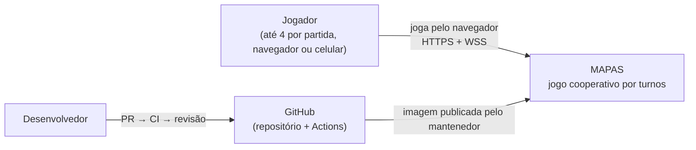
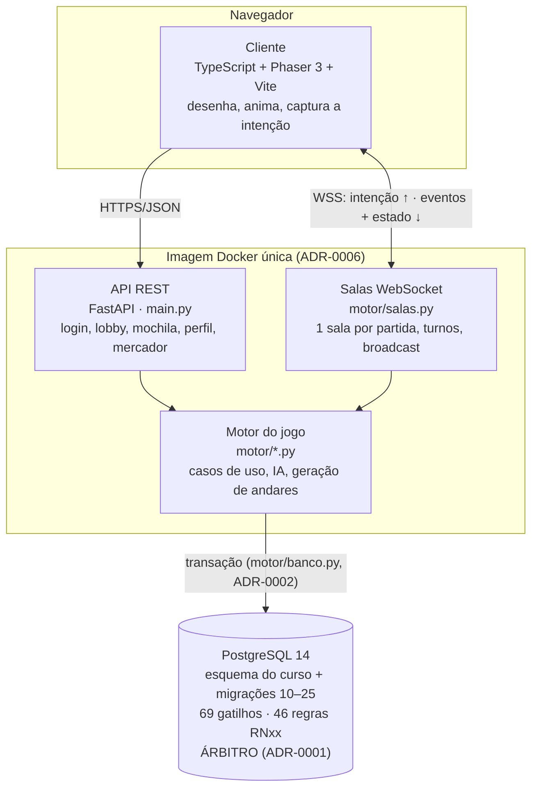
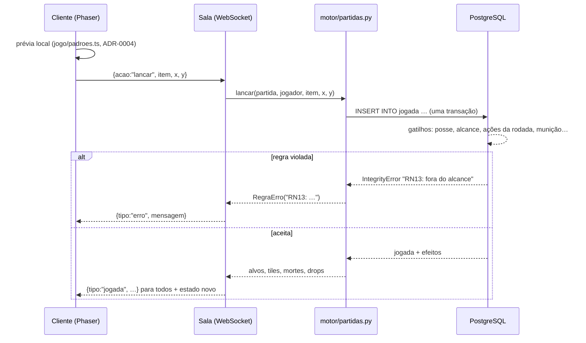

# Arquitetura do MAPAS

Visão da arquitetura **como ela é hoje** (v3), no modelo C4 (contexto → contêineres → componentes), mais o fluxo
de uma jogada e o mapa das decisões. O contrato detalhado de mensagens e rotas continua em
ARQUITETURA_V3.md *(repositório completo)*; o porquê de cada escolha está nos [ADRs](adr/README.md).

## 1. Contexto (C4 nível 1)

## 2. Contêineres (C4 nível 2)

## 3. Camadas do servidor (C4 nível 3, simplificado)

| Camada | Módulos | Pode depender de | Regra vigiada por |
|---|---|---|---|
| Transporte | `main.py` (REST), `motor/salas.py` (WebSocket) | aplicação, domínio, infra | só elas importam FastAPI |
| Aplicação (casos de uso) | `partidas`, `turno`, `mochila`, `expedicao`, `pvpve`, `magias_*`, `mercador`, `perfil`, `sessao`… | domínio, infra | ninguém importa `main`; `salas` só é usada pelo transporte |
| Domínio puro | `padroes`, `formas`, `grade`, `ia`, `chefes`, `masmorra`, `spawn`, `efeitos`, `chao` | só outros módulos puros | sem banco, rede ou framework |
| Infra | `motor/banco.py` | `psycopg2` | único que importa `psycopg2` |
| Árbitro | `sql/NN_*.sql` (constraints e gatilhos) | — | toda recusa com `RNxx:`; publicada não muda |

No cliente, a mesma ideia: `api.ts` é o único que faz HTTP, `jogo/partida.ts` o único que abre WebSocket, Phaser
só dentro de `jogo/`, e um núcleo puro (`jogo/padroes.ts`, `mochila/forma.ts`, `mochila/regras.ts`…) sem DOM nem
Phaser. Tudo isso é teste: [`servidor/testes/test_arquitetura.py`](../../servidor/testes/test_arquitetura.py) e
[`cliente/src/arquitetura.teste.mjs`](../../cliente/src/arquitetura.teste.mjs).

## 4. Fluxo de uma jogada

## 5. Atributos de qualidade e táticas

| Atributo (ISO/IEC 25010) | Cenário | Tática na arquitetura |
|---|---|---|
| Integridade / correção funcional | Dois jogadores pisam no mesmo loot na mesma fase | Regra no banco, transação e constraint (ADR-0001) |
| Segurança (confidencialidade) | Jogador tenta jogar com o cliente alterado | Servidor autoritativo; token HMAC; mensagem do banco traduzida (ADR-0002/0003) |
| Desempenho | Prévia do golpe sem esperar a rede | Núcleo puro espelhado no cliente (ADR-0004) |
| Disponibilidade | Consulta lenta trava o servidor compartilhado | `statement_timeout` de 5 s e pool com semáforo (`banco.py`) |
| Manutenibilidade / modificabilidade | Trocar o framework web ou o driver | Camadas com dependência para dentro, vigiadas por teste |
| Testabilidade | Testar regra de golpe sem banco | Domínio puro + vetores compartilhados; banco descartável no CI |
| Portabilidade / implantação | Subir em outro servidor | Imagem única + migrações automáticas (ADR-0005/0006) |

## 6. Evolução v1 → v3

| | v1 (03/10) | v2 (04/10) | v3 (04/10) | v3 + ES (11/2026) |
|---|---:|---:|---:|---:|
| Linhas de código (servidor + cliente) | 1.662 | 15.622 | 23.458 | 23.676 |
| Módulos do motor | 8 | 19 | 27 | 27 |
| Migrações do jogo / gatilhos | 1 / 4 | 9 / 44 | 16 / 69 | 16 / 69 |
| Funções de teste (servidor + cliente) | 26 | 419 | 749 | 795 |
| Integração contínua / testes de arquitetura | não / não | não / não | não / não | sim / sim |

Os números vêm de [`engsoft/evolucao/medir.py`](../../../../engsoft/evolucao/medir.py), que extrai cada versão do
git e mede todas com a mesma régua. O estilo (cliente-servidor autoritativo com o banco como árbitro) não mudou da
v1 à v3; o que cresceu foi o motor, e o que mudou depois foi **como a arquitetura é protegida**.
